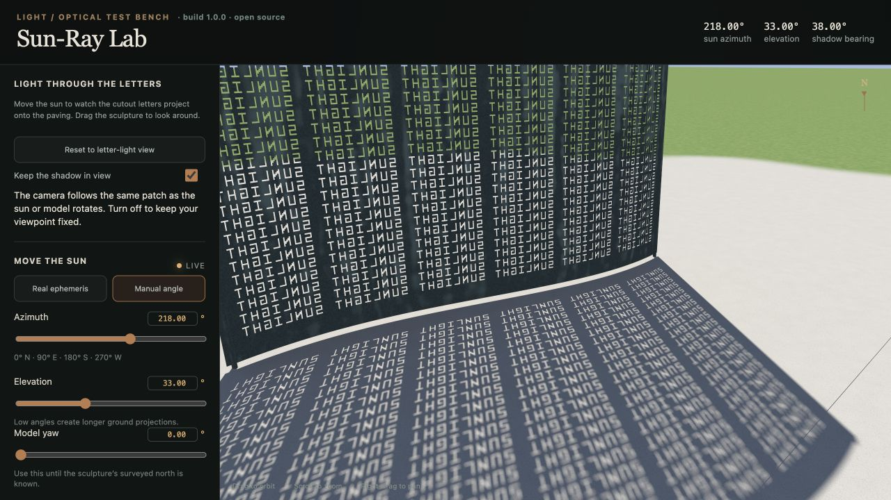

# Sun-Ray Lab

Explore how sunlight passes through a cut-letter sculpture and projects onto the ground. Change the sun's angle and the sculpture's rotation, then move around the scene to inspect the light.

Sun-Ray Lab began as a way to explore the light around Jim Sanborn's *Kryptos* without visiting CIA headquarters. This public release includes an original procedural demo sculpture, so you can run it immediately. Third-party Kryptos models and reference photography are not bundled.



## Run locally

Use Node.js **22.12 or later** and a browser with WebGL 2 and hardware acceleration enabled.

```sh
git clone https://github.com/mahdi-salmanzade/sun-ray-lab.git
cd sun-ray-lab
npm ci
npm run dev
```

Open [localhost:5173](http://127.0.0.1:5173/). The included demo needs no model downloads or Blender installation.

## Explore the light

- Adjust **sun azimuth**, **elevation**, and **model yaw** to change the projection.
- Enable **Keep the shadow in view** to follow it as the angles change.
- Use **Reset to letter-light view** to return to the starting view.
- Inspect the ground in the close-up views and compare a point sun with the finite solar disc.

The renderer traces rays against the actual mesh triangles, including the letter openings and their walls. Progressive sampling across the solar disc produces soft shadow edges. Changes appear immediately, then refine while the view settles. Thick or obliquely lit openings can naturally project only narrow strips of light.

This is an interactive light study. Materials, ambient illumination, surroundings, dimensions, and geographic alignment are approximations; it is not a survey of the sculpture or a claim about its cipher.

## Optional Kryptos models

If you already have a compatible Sun-Ray Lab asset directory and permission to use its contents locally, import it with:

```sh
npm run assets:import -- /absolute/path/to/existing/sun-ray-lab/public
```

The importer copies supported assets into ignored local paths:

- `kryptos.glb`
- `kryptos_thin.glb`
- `kryptos_screen.glb`
- `kryptos_screen_layout.json`
- An optional reference photograph, when present in the supported source layout.

The app uses the rebuilt Kryptos model when available and otherwise starts with the included demo. The model selector also lets you return to the original demo.

Bret L. Bowen's model distribution specifies redistribution as its original ZIP. Converted or modified models are therefore excluded from this repository, and the original ZIP is not included either. Imported models and photographs retain their owners' terms; the project's MIT license does not cover them. Do not commit imported assets or include them in a public build without permission.

## Development and verification

```sh
npm test
npm run build
npm run preview
```

Unit tests cover projection geometry, shadow-following behavior, and rays through the demo’s letter openings and solid copper. CI runs tests and the production build on Node.js 22 and 24.

For browser diagnostics, open [the verification view](http://127.0.0.1:5173/?verify=1) while the development server is running. It provides GPU/CPU visibility comparisons. Optional tools in `tools/` also support browser captures and independent Blender comparisons; those require their own local browser, Blender, and model setup and are not needed to use the demo.

Built with [Three.js](https://threejs.org/), [three-mesh-bvh](https://github.com/gkjohnson/three-mesh-bvh), and [Vite](https://vite.dev/).

## Contributing and license

Bug reports and contributions are welcome. See [CONTRIBUTING.md](CONTRIBUTING.md).

Original source code and the procedural demo are [MIT licensed](LICENSE), © 2026 Mahdi Salmanzade. Dependencies and optional third-party assets retain their respective licenses; see [third-party notices](THIRD_PARTY_NOTICES.md). This is an independent project, unaffiliated with Jim Sanborn or the CIA.
